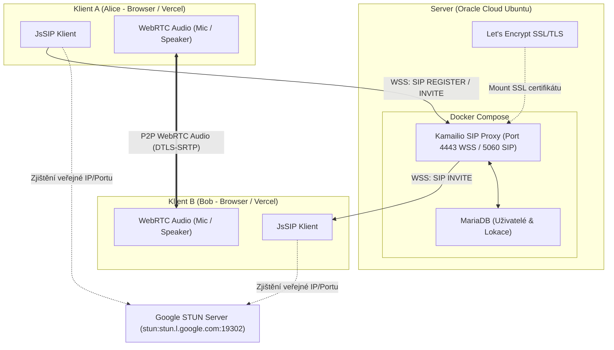

# Architektura: WebRTC a SIP přes WebSockets (Kamailio)

## Přehled Architektury

## Komponenty a toky dat

1. **Signalizace (SIP over WSS):**
   - Webový prohlížeč naváže šifrované spojení WebSocket (`wss://<domena>:4443`).
   - Kamailio zachytí WebSocket upgrade požadavek v `event_route[xhttp:request]` a přepne na SIP protokol.
   - Prohlížeče si vyměňují SIP zprávy (REGISTER, INVITE, 200 OK, ACK, BYE) a SDP (Session Description Protocol) zapouzdřené ve WebSocket rámcích.

2. **Databáze (MariaDB):**
   - Modul `auth_db` ověřuje uživatelská hesla (digest HA1) z tabulky `subscriber`.
   - Modul `usrloc` udržuje aktivní lokace a WebSocket spojení v tabulce `location`.

3. **Média (WebRTC DTLS-SRTP):**
   - Zvukový proud (audio) neprochází přes Kamailio – po signalizační fázi se naváže přímé peer-to-peer (P2P) spojení mezi prohlížeči.
   - Zabezpečení je zajištěno protokolem DTLS pro výměnu klíčů a SRTP pro šifrování hlasových paketů.
   - Překonání NAT je řešeno pomocí veřejného STUN serveru Google (`stun.l.google.com:19302`).
